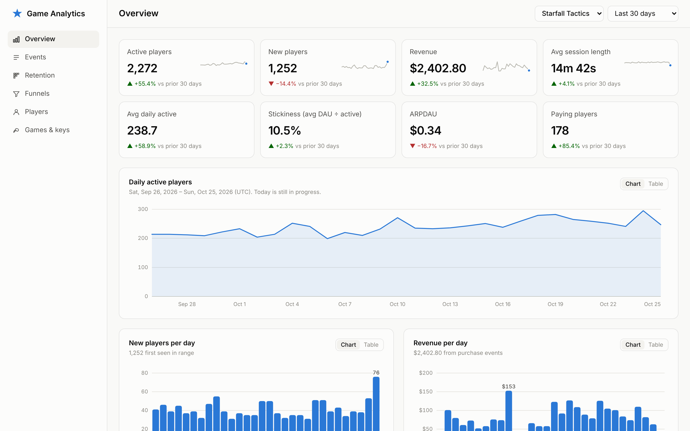
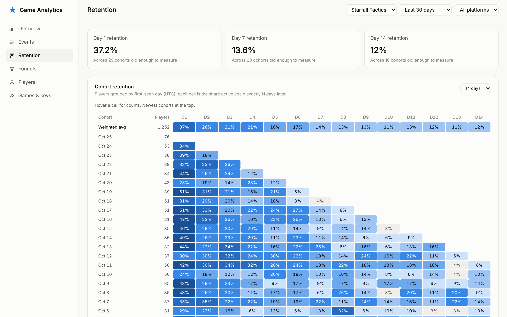
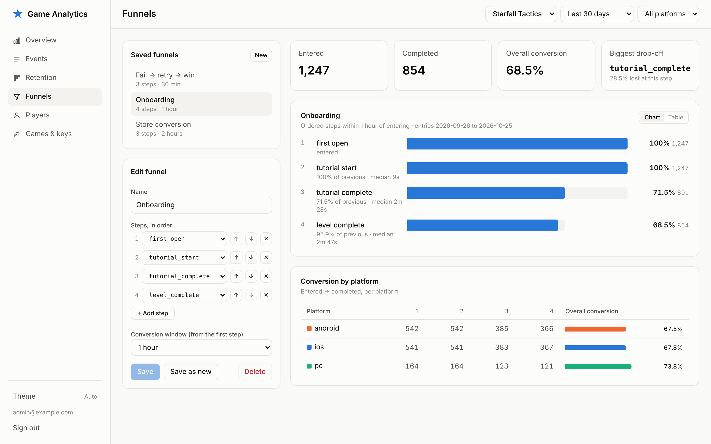
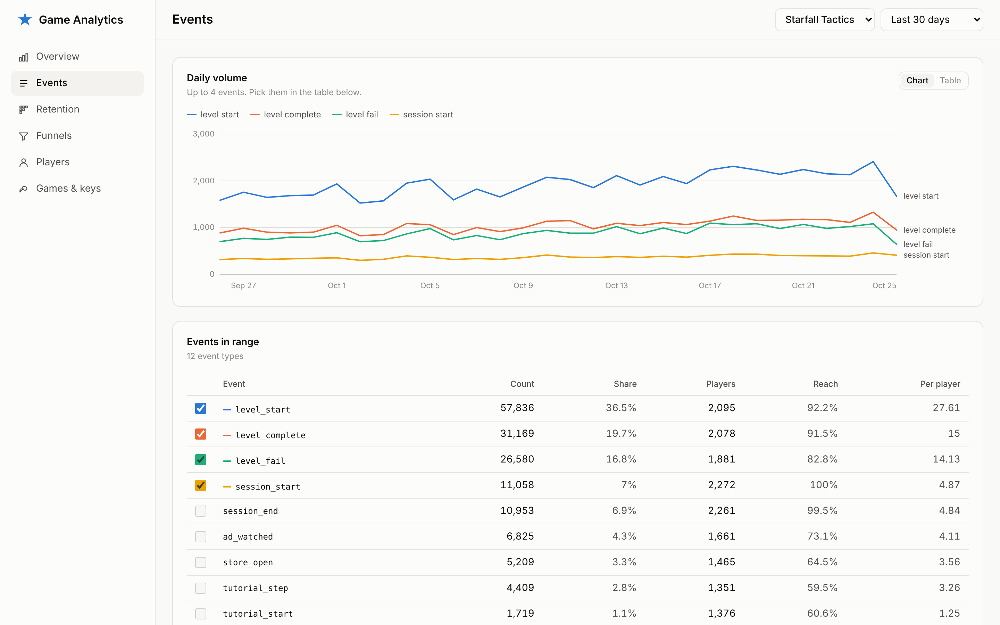
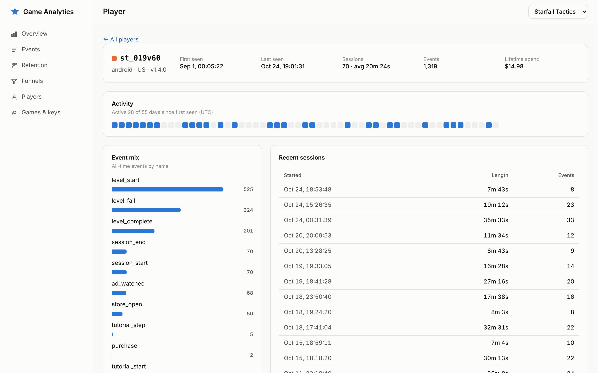

# Game Analytics Dashboard

[](https://github.com/GodfreysDragon/game-analytics-dashboard/actions/workflows/tests.yml)

A self-hosted analytics backend for games, with a Vue admin dashboard on top. Game clients or servers send gameplay
events to a Laravel ingestion API. The dashboard turns those events into KPIs, event trends, cohort retention, funnels
and per-player timelines.

It doesn't include any gameplay code. A seeded simulator produces 60 days of realistic telemetry for a fictional
tactics game, so every chart has real data behind it.

**Stack:** Laravel 13 · PHP 8.4 · Vue 3 + Vue Router · Tailwind 4 · SQLite by default (no driver-specific SQL, so
MySQL and Postgres also work) · hand-built SVG charts (no chart library)



| Cohort retention | Funnel builder |
|---|---|
|  |  |
| **Event trends** | **Player profile** |
|  |  |

## Quick start

Needs PHP 8.4, Composer and Node 22.

```sh
composer install
cp .env.example .env && php artisan key:generate
php artisan migrate:fresh --seed     # ~280k simulated events; takes a minute or two
npm install && npm run build
php artisan serve                    # http://localhost:8000
```

Sign in with **admin@example.com / password**.

For a quicker look, seed less history: `DEMO_DAYS=14 php artisan migrate:fresh --seed` takes about 5 seconds.

To stream live traffic while the dashboard is open (watch **Events → Live event stream**):

```sh
# through the real HTTP ingestion endpoint
php artisan analytics:simulate --http=http://localhost:8000 --key=gk_demo_starfall_tactics_local_only
# or write directly, without HTTP
php artisan analytics:simulate
```

## Sending events

```http
POST /api/v1/events
Authorization: Bearer gk_...            (or X-Game-Key: gk_...)
Content-Type: application/json

{
  "events": [
    {
      "uuid": "5f0c6c1e-2b0e-4c4b-9d5a-0d6f7d6f1a11",
      "name": "level_complete",
      "player_id": "player-123",
      "session_id": "sess-1",
      "timestamp": "2026-10-04T18:30:00.000Z",
      "value": null,
      "properties": { "level": 4, "stars": 3 },
      "platform": "pc",
      "country": "GB",
      "app_version": "1.4.0"
    }
  ]
}
```

The response is `202 {"accepted": 1, "duplicates": 0, "new_players": 1}`.

| Rule | Detail |
|---|---|
| Batches | 1–500 events. One invalid event rejects the whole batch with a 422 that names the field. |
| Idempotency | `uuid` is unique per game. Resending a batch is safe, even while the first attempt is still in flight: repeats are counted as `duplicates` and never double-count a rollup. |
| Sessions | `session_id` only needs to be unique per player, so a per-device counter like `"1"`, `"2"` is fine. |
| Names | snake_case, at most 64 characters. Unknown fields are rejected. |
| Time window | No older than 30 days, and no more than 10 minutes in the future (to catch bad device clocks). Both are configurable in `config/analytics.php`. |
| Properties | A JSON object with at most 50 keys and 4 KB when encoded. |
| Revenue | `value` on a `purchase` event counts as revenue (USD). |
| Rate limit | 600 requests per minute **per game**, keyed on the ingest key rather than the IP. |
| Keys | Only a SHA-256 hash is stored. The plaintext key is shown once, when a game is created or its key is rotated. |

## How it works

### Write path: raw events plus rollups in one transaction

`App\Ingestion\EventIngestor` writes the raw `events` row and, in the same transaction, keeps three rollups in step:

- **`players`**: first and last seen, latest device context, event and session counts, lifetime spend. Rows are locked
  with `lockForUpdate` before anything is counted, and counters use `col = col + n`. The duplicate check is repeated
  once the locks are held, so two copies of a batch arriving at the same moment are counted once.
- **`player_activity_days`**: one row per player per active UTC day, holding the player's `cohort_on` and `day_index`.
  DAU is a `COUNT(*)`. Cohort retention is `GROUP BY cohort_on, day_index`. Neither needs date maths in SQL, which
  keeps the queries portable and index-only.
- **`game_sessions`**: start, end, duration and event count, merged across batches when a session's events arrive
  in pieces.

**Late events.** If buffered offline play arrives with a timestamp earlier than the player's first-seen time, the
player moves to the earlier cohort and their existing activity days are re-indexed.

### Read path: `App\Analytics\*`

| Report | Approach |
|---|---|
| `OverviewReport` | KPIs (active players, average DAU, new players, stickiness, sessions, session length, revenue, payers, ARPDAU, ARPPU), each compared with the previous period of equal length. Daily series are gap-filled. |
| `EventsReport` | Volume, unique players, reach and per-player rate for each event name, plus daily trends for up to 4 names. |
| `RetentionReport` | Classic N-day cohort matrix (7, 14 or 30 days). Days that haven't happened yet are `null`, not `0`, and are left out of the size-weighted averages. Can be filtered by platform. |
| `FunnelReport` | Ordered steps within a conversion window that starts at entry. Entry has to fall inside the date range, but later steps may finish after it. When a player enters several times, the attempt that got furthest counts. Also returns the median time between steps and a per-platform breakdown. Events are streamed with a cursor and evaluated per player in PHP, so the same code runs on any database. |

### Dashboard

- A Vue 3 single-page app talking to `/api/admin/*`. It uses session auth and the CSRF token (no token is stored in
  the browser), and the routes are scoped to the game (`scopeBindings`), so one game's funnels and players can't be
  reached through another game's URL.
- **Pages:** Overview, Events (with a live tail that polls `after_id`), Retention heatmap and curve, Funnel builder
  (unsaved edits are previewed live), Players search, Player profile and timeline, and Games & keys.
- **Charts** are plain SVG components with crosshair or per-mark tooltips and keyboard focus. Every chart has a table
  view.
- **Colour:** each platform keeps the same colour on every page, and a selected event keeps its colour when you
  toggle others. The categorical palette was checked for colour-blind separation in both light and dark modes.
- Filters scope the whole page. Data refetches keep the previous render dimmed instead of flashing. Dark mode has its
  own selected colours (not an inversion) and follows the system setting or a manual toggle.

## Tests

```sh
php artisan test     # ingestion, reports, dashboard API, simulator command
vendor/bin/pint      # code style
```

Covered:

- **Ingestion:** key authentication, idempotent retries (including one that commits while another request waits for
  its locks), duplicates inside a batch, late-event cohort moves, sessions merged across batches and scoped per player,
  validation rules, the per-game rate limit, key rotation.
- **Retention:** matrix values, unobserved days, weighted averages, the platform filter.
- **Funnels:** ordering, the window boundary, picking the best attempt, range edges, repeated step names, the platform
  breakdown.
- **Overview:** KPIs, deltas, gap-filling.
- **Dashboard API:** auth, game isolation, filter validation, LIKE-wildcard escaping in player search, the stream's
  `after_id`.
- **`analytics:simulate`:** direct writes, the HTTP path (with `Http::fake()`), a rejected key, bad arguments.

GitHub Actions runs the suite, Pint and the frontend build on every push and pull request.

## Simulated storyline

`App\Simulation\GameSimulator` is seeded, so the same seed always produces the same history. It builds in a few things
to find:

- Retention decays on a power curve and is a little weaker on Android.
- A three-day paid user-acquisition burst (around 40% of the way through the range) brings lower-intent installs.
  It shows as a spike in new players and weaker cohorts.
- Client 1.4.0 ships 14 days before today with a tutorial fix. Tutorial completion rises from about 60% to 80%.
  Compare the **Onboarding** funnel over the last 14 days with an earlier range.

## Design decisions and trade-offs

- **Rollups are written with the raw events, not by a job.** Reports read small, pre-shaped tables (DAU is a
  `COUNT(*)`, retention is one `GROUP BY`), so they stay fast without a warehouse. The price is a heavier write: a batch
  of 500 events commits in one transaction. That is fine for a self-hosted game of modest size, and a retry after a
  timeout is always safe.
- **Portable SQL only.** Dates are denormalised into `*_on` columns at write time, so nothing needs `DATE()`,
  `date_trunc` or window functions. The same queries run on SQLite, MySQL and Postgres.
- **Funnels are evaluated in PHP.** Events are streamed with a cursor and walked per player. Ordered, windowed,
  best-attempt funnels are awkward to express portably in SQL; in PHP the logic is short, readable and fully tested.
  It is the slowest report (0.2–1 s on the seeded data) and the first thing to move if volume grew.
- **Charts are hand-built SVG.** No chart library: each chart is a small Vue component with tooltips, keyboard focus
  and a table view, and the colour palette is checked for colour-blind separation in light and dark modes.
- **UTC calendar days throughout.** The last day of a range is partial, and the DAU chart says so.

## Known limitations

- **Segments use the player's latest device context.** Filtering retention or funnels by platform uses the platform
  the player most recently reported, not the one each event was sent from.
- **Single tenant.** Every signed-in admin can see every game, and the only account is the seeded one. A game–user
  pivot and a policy would slot in behind the existing `scopeBindings` routes.
- **Not built for millions of events a day.** Ingestion is synchronous and `events` is a single table.

## Roadmap

1. Queue ingestion (write raw events, roll up in a job) and partition or archive `events` by month.
2. Property breakdowns (e.g. `level_fail` by `properties.level`) using generated columns or a property table.
3. Saved segments (platform, country, app version, payer) applied to every report.
4. CSV export from each table view, and scheduled email digests.
5. Funnel comparison: two date ranges side by side, e.g. before and after the 1.4.0 tutorial fix.
6. Revenue reports: LTV curves by cohort and a breakdown of purchases by item.
7. An `artisan make:admin` command and password reset.

## License

[MIT](LICENSE)
